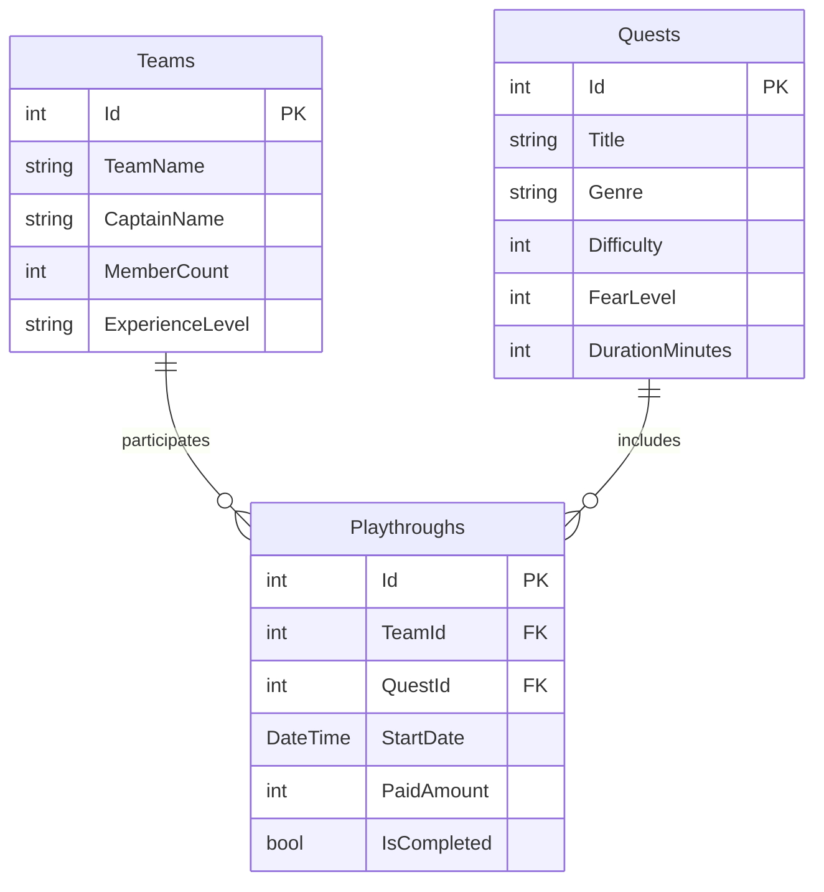

# QuestPoint

Приложение для управления командами игроков, квестами и их прохождениями в квест-комнате.

## Автор

- Фамилия: [Ваша фамилия]
- Имя: [Ваше имя]
- Группа: [Ваша группа]

## О проекте

**Тема:** Квест-комнаты.

**Название заведения:** QuestPoint.

QuestPoint — это современная квест-комната, в которой посетители могут участвовать в приключениях разных жанров. Команды игроков могут выбирать квесты по сложности, жанру и уровню страха. Приложение позволяет хранить информацию о командах, доступных квестах и истории прохождений. Особенность заведения — наличие квестов с разными сюжетами и уровнями сложности.

## Схема базы данных

## Таблицы

### 1. Teams

Хранит информацию о командах, посещающих квест-комнату.

| Поле | Тип | Обязательное | Описание |
|---|---|---|---|
| Id | int | Да | Первичный ключ |
| TeamName | string | Да | Название команды |
| CaptainName | string | Да | Имя капитана |
| MemberCount | int | Да | Количество участников |
| ExperienceLevel | string | Да | Уровень опыта команды |

### 2. Quests

Хранит информацию о доступных квестах.

| Поле | Тип | Обязательное | Описание |
|---|---|---|---|
| Id | int | Да | Первичный ключ |
| Title | string | Да | Название квеста |
| Genre | string | Да | Жанр квеста |
| Difficulty | int | Да | Сложность от 1 до 5 |
| FearLevel | int | Да | Уровень страха от 1 до 5 |
| DurationMinutes | int | Да | Продолжительность в минутах |

### 3. Playthroughs

Хранит информацию о прохождениях квестов командами.

| Поле | Тип | Обязательное | Описание |
|---|---|---|---|
| Id | int | Да | Первичный ключ |
| TeamId | int | Да | Внешний ключ на Teams |
| QuestId | int | Да | Внешний ключ на Quests |
| StartDate | DateTime | Да | Дата и время начала |
| PaidAmount | int | Да | Стоимость прохождения в рублях |
| IsCompleted | bool | Да | Завершён ли квест |

## Связи

- Teams и Playthroughs связаны через внешний ключ TeamId.
- Quests и Playthroughs связаны через внешний ключ QuestId.
- Одна команда может проходить множество квестов.
- Один квест могут проходить множество разных команд.

Таким образом, между Teams и Quests реализована связь «многие ко многим» через связующую таблицу Playthroughs.
